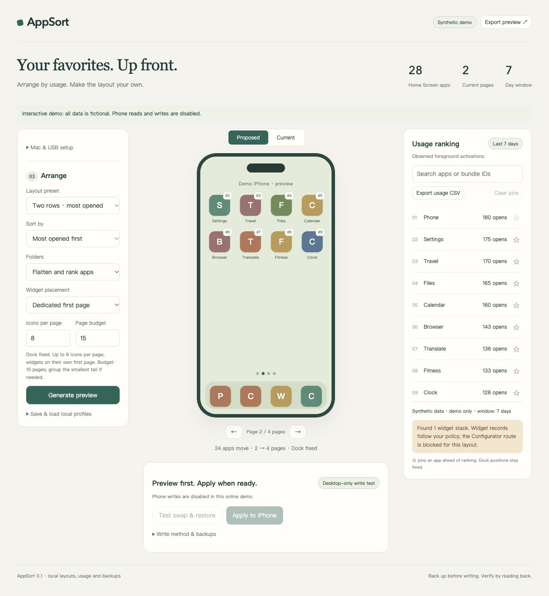
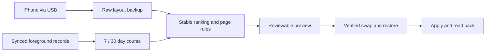

# AppSort — iPhone Home Screen, sorted by usage

Put the iPhone apps you actually open at the front, instead of dragging every icon by hand.
Choose opens, time or recency; customize pages and folders; preview and verify every phone write by reading it back.
For iPhone owners with a Mac: local records, USB connection, no jailbreak.

[](https://github.com/asymptote637/iphone-appsort/actions/workflows/ci.yml)
[](https://github.com/asymptote637/iphone-appsort/releases/latest)
[](LICENSE)
[](#use-with-your-iphone)

**[Try the online demo →](https://asymptote637.github.io/iphone-appsort/demo/)** · [Download](https://github.com/asymptote637/iphone-appsort/releases/latest) · [简体中文](README.zh-CN.md) · [Discussions](https://github.com/asymptote637/iphone-appsort/discussions)



*The screenshot and online demo use fictional app counts. They never connect to a phone.*

> **Before using a real phone:** the first layout write may bring App Library Only apps back onto the Home Screen. A layout backup cannot guarantee restoring that state or hidden-page settings. Live verification currently covers **one iPhone 17 / iOS 27.0 (24A437)**; test your own device before batch application.

## Contents

- [Try it without a phone](#try-it-without-a-phone)
- [What AppSort does](#what-appsort-does)
- [Use with your iPhone](#use-with-your-iphone)
- [Compatibility and evidence](#compatibility-and-evidence)
- [How it works](#how-it-works)
- [Related tools](#related-tools)
- [FAQ](#faq)
- [Contribute](#contribute)

## Try it without a phone

Use the **[online demo](https://asymptote637.github.io/iphone-appsort/demo/)**, or run the real UI locally with **Python 3.11+**. The local demo needs no third-party packages, Mac, USB device, or private records:

```bash
git clone https://github.com/asymptote637/iphone-appsort.git
cd iphone-appsort
python3 -m appsort --demo serve --port 8767
```

Open `http://127.0.0.1:8767/`. Try four presets, opens / time / recency, custom capacities, search, pins, local profiles and CSV export. Demo phone reads and writes are disabled. Close the terminal or press Ctrl+C to stop.

Demo values are fixed fictional examples in either window; changing 7 / 30 days does not claim actual measurements. The desktop UI currently uses Chinese labels; the static online demo translates the main controls into English. Both READMEs describe the workflow.

## What AppSort does

- **Three ranking modes:** observed opens, accumulated foreground time, or the latest foreground timestamp. Choose a 7- or 30-day window; unknown usage stays last with stable ordering.
- **Four editable presets:** two rows, full pages, preserved folders, and recent apps. Presets are starting points, not fixed rules.
- **Custom page density:** 1–24 icons per app page and a 1–15 total-page budget, including widget pages but excluding Dock. Only the necessary lowest-ranked tail is grouped when the budget is tight; ambiguous folder merges are refused.
- **Folder and widget policies:** flatten folders or keep and rank them; keep widgets at their original positions or collect intact stacks on a first page. Dock always stays fixed.
- **Pins, search and reusable profiles:** pin apps ahead of automatic ranking, find apps by name or bundle ID, and save named settings locally.
- **Import and export:** import a CSV with opens, optional seconds and timezone-aware `last_open`; export the full usage table or a JSON preview for your own records.
- **Backups and verified writes:** preserve raw plist records, back up before every write, and read the result from the selected phone. Ignored, partial and unconfirmed results stay distinct from success.
- **Local processing:** private state is gitignored and excluded from release bundles. The desktop server binds only to 127.0.0.1; the hosted demo contains synthetic data only.
- **Terminal and Codex workflows:** the CLI shares the GUI's validation. An optional [Codex skill](codex-skill/iphone-appsort/SKILL.md) is included.

### Pick a starting layout

| Preset | Ranking | Icons per page | Folders | Widgets |
|---|---|---:|---|---|
| Two rows | Opens | 8 | Flatten | Dedicated first page |
| Full pages | Opens | 24 | Flatten | Original positions |
| Keep folders | Time | 16 | Preserve | Original positions |
| Recent apps | Recency | 12 | Flatten | Dedicated first page |

Every preset is editable. The two-row placement applies to app pages with a separate widget page. Widget area still takes space when keeping original positions; AppSort checks the combined area before producing a preview. Preserved folders rank by the sum of opens/time or their most recently used child.

Save a profile from **Save & load local profiles**. The same name updates a profile; loading one changes settings and requires a fresh preview before application. Profiles live in private `state/profiles.json` and never schedule phone writes. The hosted demo stores only its fictional profiles in your browser.

CSV columns are `bundle_id,opens,seconds,last_open`. `opens` is required; the last two are optional. Recency requires an ISO timestamp with a timezone, such as `2026-01-01T08:00:00+08:00`. [Example CSV](examples/counts.csv).

## Use with your iPhone

### Requirements

| Component | Requirement |
|---|---|
| Phone workflow | macOS, Python 3.11+, iPhone connected over USB, unlocked and trusting the Mac |
| Usage ranking | Same Apple ID, Screen Time **Share Across Devices**, synced foreground records |
| Usage copy helper | Xcode Command Line Tools / `swiftc`, Full Disk Access granted to the compiled helper |
| Optional cfgutil route | **Mac** Apple Configurator; widget layouts are blocked from this route |
| Demo / tests | Python 3.11+; no phone or device dependencies |

### Install and open

```bash
git clone https://github.com/asymptote637/iphone-appsort.git
cd iphone-appsort
bin/setup
bin/appsort serve
```

Or download the source ZIP and double-click **Setup AppSort.command**, then **Start AppSort.command**. Install Python and Xcode Command Line Tools first if missing. No Docker deployment is needed for the Mac/USB workflow.

In **System Settings → Privacy & Security → Full Disk Access**, add `bin/appsort-usage-helper`. Review its [small Swift source](helper/screentime-copy.swift) before granting this broad macOS permission. The helper only copies synced App.InFocus streams and device metadata. It does not change your permissions or upload records.

### Organize

1. Connect and unlock the phone. Choose the correct USB device and read its layout.
2. Copy synced records, select the corresponding device stream, and calculate the 7- or 30-day counts. Old phones can remain in the stream list; choose deliberately.
3. Choose a preset or your own rules, then generate a preview. Check the page count, widget policy, pins, and any tail folder.
4. Run **swap & restore**. This temporarily changes two icons, reads the result, then restores and verifies it. The exact device / iOS / backend must pass before batch application.
5. Apply the reviewed preview. If the phone changed after previewing, read it again rather than bypassing the check.

Initial Screen Time sync can take hours. Records may lag the phone; the UI shows the newest observed timestamp. App resumes count as opens, but process cold starts and pickups are different measures.

For example, after reading your phone and collecting matching records:

```bash
bin/appsort propose --metric recent --days 7 --capacity 12 --page-limit 10 --folders preserve --widgets separate
bin/appsort propose --metric opens --capacity 24 --widgets keep --pin com.example.app
```

Replace the example pinned ID with an app actually present on your phone. The CLI is available with `bin/appsort --help`. `test`, `apply` and `restore` prompt before writing; `--yes` means you have already reviewed and authorized that specific action.

## Compatibility and evidence

| Check | Current evidence |
|---|---|
| Software | 62 unit and HTTP integration tests, plus 288 hosted/desktop policy comparisons in [CI](https://github.com/asymptote637/iphone-appsort/actions) use simulated devices |
| Live device | One iPhone 17, iOS 27.0, build 24A437 |
| Native layout path | Actual swap, restore and final application verified by independent phone read-back |
| Final tested preset | Dedicated widget page + 14 app pages with 8 icons each; fixed Dock and complete represented app inventory |
| Usage | Actual synced Biome records decoded; foreground entries counted separately from duration |
| cfgutil | Implemented but not live-tested for this release; blocked when widgets exist |
| Other devices / versions | Unverified; a successful demo or CI run does not establish phone-write compatibility |

See the [validation notes](docs/validation.md) for observed limitations and their handling. These are compatibility observations, not speed benchmarks or a promise of universal support.

## How it works



Python handles ranking, validation, storage and the loopback UI server. `pymobiledevice3` reads the selected USB phone. A narrowly scoped Swift helper copies Screen Time records, and `ccl-segb` reads their container format. Native raw-layout writes preserve the widget records returned by the device. A one-off helper job is removed after use; there is no periodic background task.

## Related tools

| Tool | Documented focus | Why use AppSort? |
|---|---|---|
| Manual iPhone arrangement | Drag icons on the phone | Generate a usage-ranked preview for many apps |
| [Appabetical](https://github.com/Avangelista/Appabetical) | Alphabetical / color sorting; README limits support to iOS 14–16.1.2 | Observed-open ranking, Mac preview and per-device verification |
| [homescreen-organizer](https://github.com/justinleveck/homescreen-organizer) | Mac editor, Screen Time ranking, Claude Code skill | Opens / time / recency, editable presets, profiles and explicit capability gating |
| [iphone-layout-tool](https://github.com/tmad4000/iphone-layout-tool) | cfgutil layout conversion / push | Integrated usage collection, preview, backups and read-back classification |

AppSort builds on these investigations. Upstream permissions and acknowledgments are preserved in [THIRD_PARTY_NOTICES.md](THIRD_PARTY_NOTICES.md); the Biome collector and Swift helper adaptations retain the upstream MIT notice.

## FAQ

**Is this an iPhone app or launcher extension?** It is a Mac tool with a browser UI and optional Codex skill. It does not install a launcher on iOS.

**Does it run on the iPhone in the background?** No. Start a one-time organization from a Mac; it does not continually move icons while you use the phone.

**Does no jailbreak mean every iOS version works?** No. The tested device needed no jailbreak. Other systems still need a live swap / restore and read-back.

**Can I undo everything?** The tool saves and restores represented icon layouts, but this is not a full iPhone backup. App Library Only state and hidden-page settings may not be restored by the API.

**Why did an app reappear on the Home Screen?** That was observed during the first write. AppSort reports the resulting inventory mismatch and stops the stale batch proposal. The original library-only state may need manual restoration on the phone.

**Why are some icons letters?** Icon artwork is cosmetic; missing art never changes the app inventory or ranking. The online demo uses generated letter icons.

**Is my usage sent to GitHub?** No. Desktop `state/` stays local. The hosted demo contains only fictional data.

## Contribute

Read [CONTRIBUTING.md](CONTRIBUTING.md), browse [good first issues](https://github.com/asymptote637/iphone-appsort/labels/good%20first%20issue), or share a question in [Discussions](https://github.com/asymptote637/iphone-appsort/discussions). Compatibility reports should include the model, system version and read-back outcome, with private data removed.

A [launch kit](docs/launch-kit.md) includes factual English and Chinese post drafts for sharing the project.

If AppSort saves you a tedious rearrangement, a star or a link in a relevant discussion helps other users find it. Useful reports and improvements are welcome too.

**License:** [GPL-3.0-or-later](LICENSE). Not affiliated with Apple.
